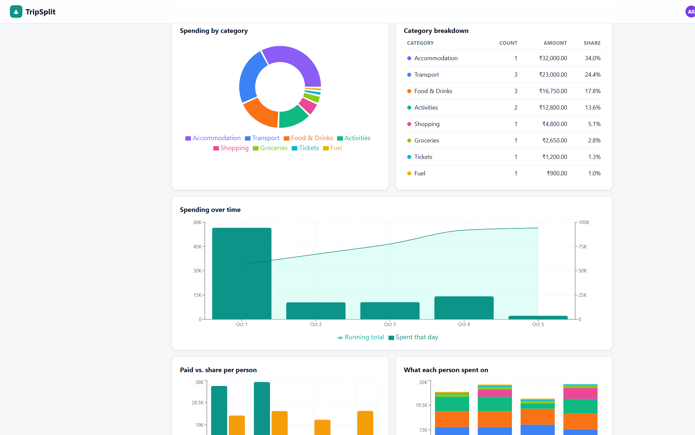
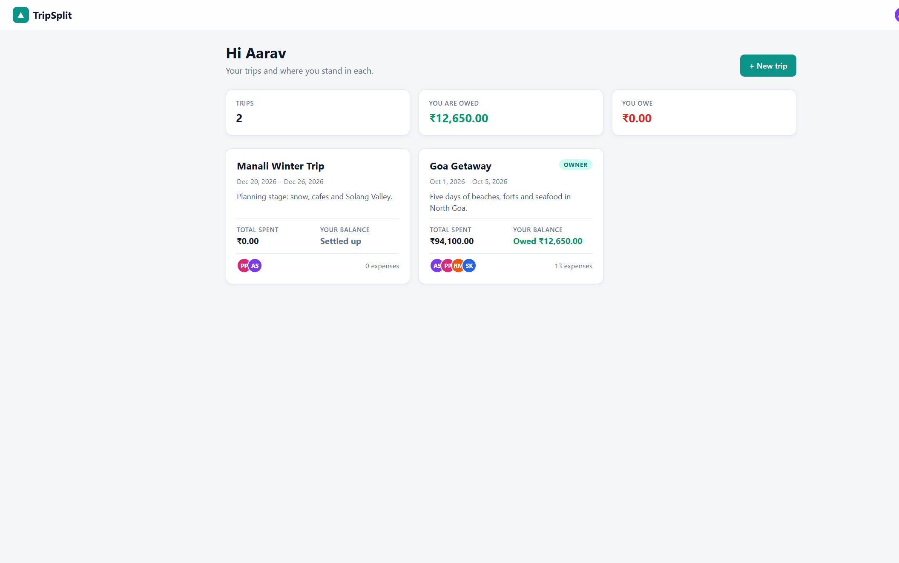
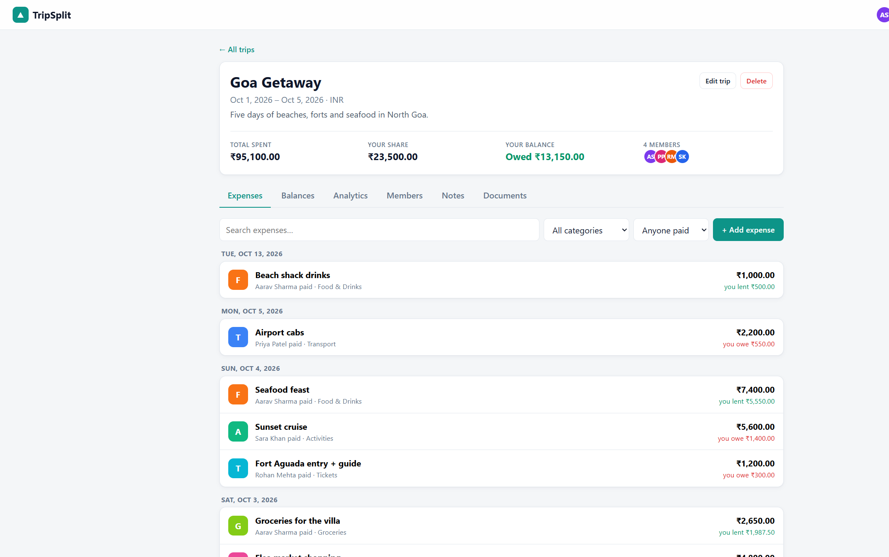
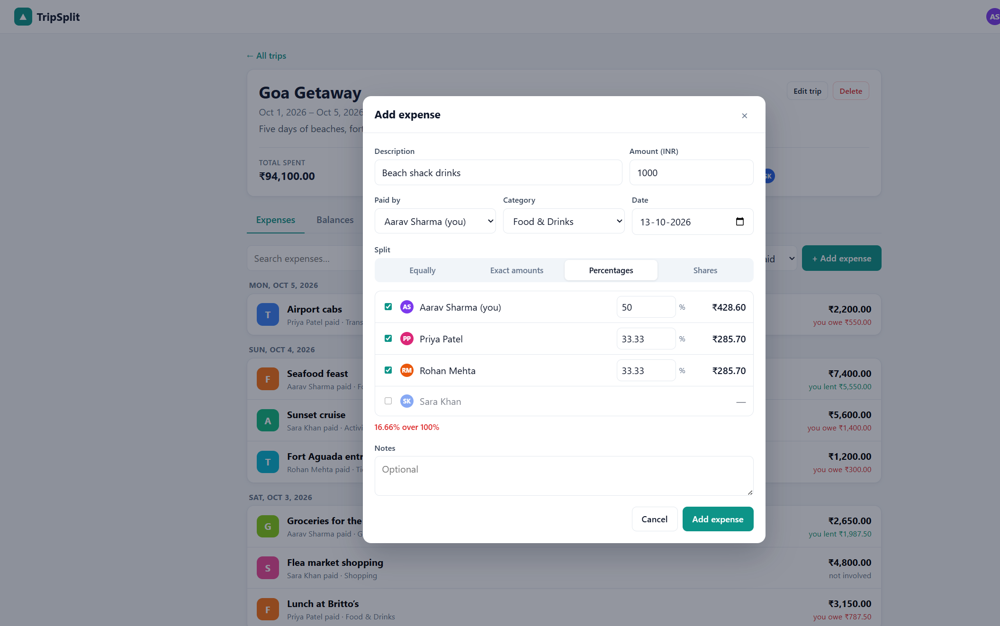
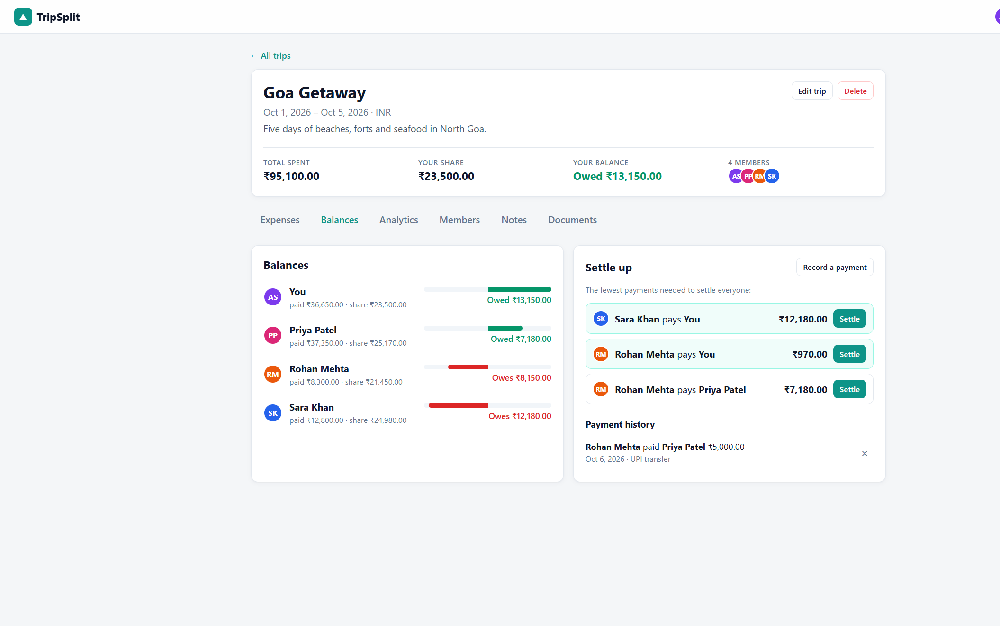
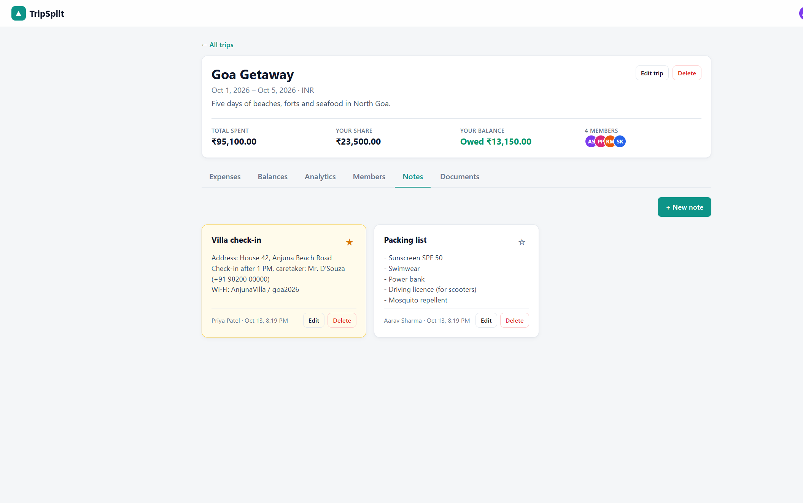
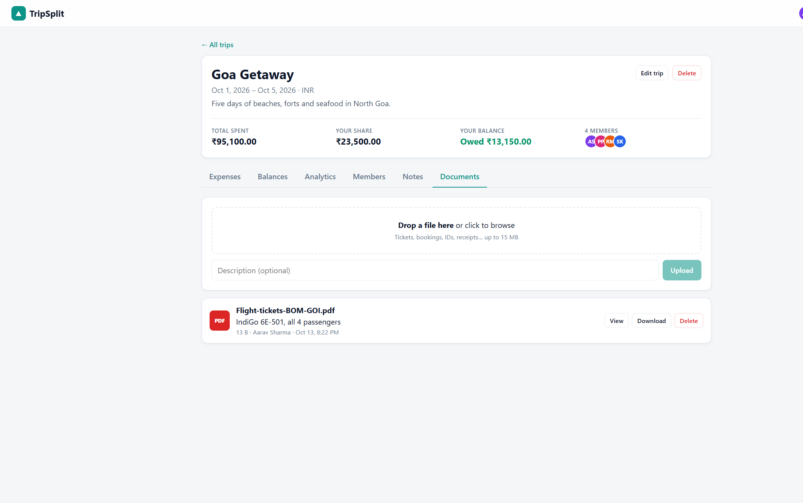

<div align="center">

# TripSplit

**Travel together. Split fairly.**

A Splitwise-style expense tracker built for group trips. Log who paid for what, split it any way you like,<br/>
see exactly who owes whom, and keep every note and booking for the trip in one place.

<br/>


<br/>


<br/>



</div>

---

## Why TripSplit?

Every group trip ends the same way: a messy chat thread, five different payment apps, and someone trying to remember who paid for the cab on day two. TripSplit gives each trip its own shared space where everyone logs expenses as they happen. When the trip is over, it tells you the **fewest payments** needed to make everyone even. No spreadsheets, no awkward maths.

## What you can do

**Plan a trip with your people.** Create a trip with its dates and currency, then add friends by the email they signed up with. They'll see it on their dashboard straight away.

**Log expenses as they happen.** Add the amount, who paid, the category and the date, then choose how to split it:

| Split type | Good for | Example |
| --- | --- | --- |
| **Equally** | Most things | A ₹6,200 dinner shared by four people |
| **Exact amounts** | Itemised bills | Parasailing: ₹2,400 each for the three who went |
| **Percentages** | Uneven arrangements | Shopping split 60 / 40 |
| **Shares** | Some people use more | Scooters: Rohan rode two days, others rode one |

The form previews everyone's share as you type and tells you if the numbers don't add up yet ("₹250 left to assign", "16.66% over 100%").

**Know where you stand.** Each person's balance shows what they paid, what their share was, and whether they're owed money or owe it. TripSplit then suggests the simplest way to settle up, and you can record each payment with a single click.

**See where the money went.** The analytics tab breaks the trip down by category, by day (with a running total), and by person: who paid vs. who consumed, and what each person spent on. It also shows the daily average, the largest expense, and how much is still outstanding.

**Keep the trip's paperwork together.** Shared notes are great for itineraries, packing lists and check-in codes, and you can pin the important ones. Upload tickets, hotel bookings, IDs and receipts so everyone can view or download them when needed.

## Screenshots

<table>
  <tr>
    <td width="50%"><p align="center"><sub><b>Dashboard</b>: all your trips and where you stand</sub></p></td>
    <td width="50%"><p align="center"><sub><b>Expenses</b>: grouped by day, with what you lent or owe</sub></p></td>
  </tr>
  <tr>
    <td><p align="center"><sub><b>Flexible splits</b>: live preview and validation</sub></p></td>
    <td><p align="center"><sub><b>Balances</b>: the fewest payments to settle everyone</sub></p></td>
  </tr>
  <tr>
    <td><p align="center"><sub><b>Notes</b>: pinned check-in info and packing lists</sub></p></td>
    <td><p align="center"><sub><b>Documents</b>: tickets and bookings for everyone</sub></p></td>
  </tr>
</table>

## Getting started

You'll need **Node.js 22.13 or newer**. TripSplit uses Node's built-in SQLite module, so there's no database to install and nothing native to compile.

```bash
git clone https://github.com/mudit-palvadi/tripsplit.git
cd tripsplit
npm install
npm run seed   # optional, but recommended: loads a sample "Goa Getaway" trip
npm run dev
```

Then open **http://localhost:5173**.

### Demo accounts

After running `npm run seed`, log in as any of these (password: `password`) and look at the same trip from each person's point of view:

| Name | Email |
| --- | --- |
| Aarav Sharma (trip owner) | `aarav@demo.com` |
| Priya Patel | `priya@demo.com` |
| Rohan Mehta | `rohan@demo.com` |
| Sara Khan | `sara@demo.com` |

### Running in production

```bash
npm run build   # bundles the frontend into dist/
npm start       # serves the API and the app together on http://localhost:4000
```

### Configuration

Everything works out of the box. Set these environment variables if you need to:

| Variable | Default | What it does |
| --- | --- | --- |
| `PORT` | `4000` | Port for the API (and the built app in production) |
| `DATA_DIR` | `server/data` | Where the SQLite database and uploaded files live |
| `JWT_SECRET` | auto-generated | Secret for signing login tokens. Generated once and saved in `DATA_DIR` if not set |

## How it works

### Money is never a float

Every amount is stored in **integer cents**, so ₹100 is stored as `10000`. When a bill doesn't divide evenly (₹100 between three people), the leftover cents go to the people with the largest rounding remainder. The result is ₹33.34 + ₹33.33 + ₹33.33: the parts always add up to the exact total, and balances always sum to zero.

### Balances

For each person in a trip:

```
net = what they paid − their share of expenses + payments they sent − payments they received
```

A positive net means the group owes them money; a negative net means they owe the group.

### Settling up

To suggest payments, TripSplit repeatedly matches the person who owes the most with the person who is owed the most. One of them is fully settled after each payment, so a group of *n* people needs **at most n − 1 payments** instead of everyone paying everyone.

## Tech stack

| Layer | Choice | Why |
| --- | --- | --- |
| Runtime | **Node.js 22** | Built-in `node:sqlite`, `--watch`, native `fetch` |
| API | **Express 4** | Small, well known, easy to read |
| Database | **SQLite** via `node:sqlite` | Zero setup, a single file, foreign keys with cascading deletes |
| Auth | **JWT** + **bcrypt** | Stateless sessions, hashed passwords |
| Uploads | **Multer** | Multipart file uploads straight to disk |
| UI | **React 18** + **React Router 6** | Component-based UI with deep-linkable trip tabs |
| Build | **Vite 6** | Instant dev server, API proxy, code-split production build |
| Charts | **Recharts** | Composable charts, lazy-loaded only on the analytics tab |

## Project structure

```
tripsplit/
├── server/
│   ├── index.js          # Express app, error handling, serves dist/ in production
│   ├── db.js             # SQLite schema and query helpers
│   ├── auth.js           # JWT, trip-membership and owner checks
│   ├── ledger.js         # Split maths, balances and settle-up suggestions
│   ├── seed.js           # Demo data
│   └── routes/           # auth, trips & members, expenses, settlements,
│                         # analytics, notes, documents
├── client/
│   ├── index.html
│   └── src/
│       ├── pages/        # Login/Register, Dashboard, Trip page + its tabs
│       ├── components/   # Expense form, trip form, shared UI
│       ├── api.js        # Fetch wrapper with auth
│       └── styles.css
└── docs/screenshots/
```

## API at a glance

All routes are under `/api`, and everything except register/login needs an `Authorization: Bearer <token>` header. Trip routes are only available to members of that trip.

| Method | Route | Purpose |
| --- | --- | --- |
| `POST` | `/auth/register`, `/auth/login` | Create an account / log in |
| `GET` | `/auth/me` | Current user |
| `GET` `POST` | `/trips` | List your trips / create one |
| `GET` `PATCH` `DELETE` | `/trips/:id` | Trip details / edit / delete (owner) |
| `POST` `DELETE` | `/trips/:id/members[/:userId]` | Add by email / remove or leave |
| `GET` `POST` `PUT` `DELETE` | `/trips/:id/expenses[/:expenseId]` | Manage expenses and their splits |
| `GET` | `/trips/:id/balances` | Balances and settle-up suggestions |
| `GET` `POST` `DELETE` | `/trips/:id/settlements[/:id]` | Recorded payments |
| `GET` | `/trips/:id/analytics` | All the numbers behind the charts |
| `GET` `POST` `PUT` `DELETE` | `/trips/:id/notes[/:noteId]` | Shared notes |
| `GET` `POST` `DELETE` | `/trips/:id/documents[/:docId]` | Upload, list and delete files |
| `GET` | `/trips/:id/documents/:docId/download` | Download a file |

## Who can do what

- **Any member** can add, edit and delete expenses and payments, write notes, and upload documents. Group trips work best when everyone can fix a typo.
- **The owner** can edit or delete the trip and remove members.
- **Members** can leave a trip whenever they like.
- Notes can be deleted by their author or the owner, and documents by their uploader or the owner.
- Someone who is part of an expense or payment can't be removed until those entries are changed. That way, balances never quietly stop adding up.

## Ideas for later

- Invite links for friends who haven't signed up yet
- Multi-currency expenses within a single trip
- Receipt photos attached directly to expenses
- CSV / PDF export of the trip summary
- Email or push reminders to settle up

---

<div align="center">
<sub>Made for friends who travel together and still want to be friends afterwards.</sub>
</div>
